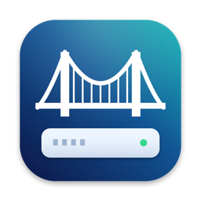
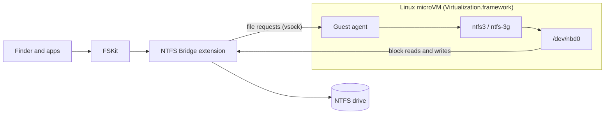

<p align="center">
  
</p>

<h1 align="center">NTFS Bridge</h1>

<p align="center">
  Read and write Windows (NTFS) drives in Finder on macOS, using the Linux kernel's own NTFS driver.
</p>

<p align="center">
  <a href="https://github.com/xscade/ntfs-bridge/releases/latest"></a>
  <a href="LICENSE"></a>
  
  
</p>

---

macOS can read NTFS drives but not write to them. NTFS Bridge adds full read and
write support without a kernel extension and without turning off any macOS
security. Plug in a Windows drive and it appears in Finder, ready to use.

## Features

- **Read and write** NTFS drives in Finder and every other app.
- **Mounts automatically.** When a Windows drive is plugged in, NTFS Bridge mounts
  it read and write. If another driver got to it first, NTFS Bridge remounts it.
- **Protects drives Windows didn't shut down cleanly.** A drive left hibernated by
  Windows Fast Startup, or one that needs a disk check, is mounted read-only with
  an explanation instead of risking your files.
- **Two NTFS drivers.** The fast in-kernel `ntfs3` driver is used first. If it
  refuses a volume, NTFS Bridge falls back to `ntfs-3g`.
- **Disk images.** Mount `.img` and `.dmg` files that contain an NTFS volume.
- **First Aid support.** Disk Utility's First Aid and `diskutil repairVolume` run
  `ntfsfix` on the drive.
- **No kernel extension.** It's a standard FSKit file system extension. Your Mac
  stays in Full Security mode.
- **Signed and notarized** by Apple, so it opens without Gatekeeper warnings.

## Requirements

- A Mac with **Apple silicon** (M1 or later)
- **macOS 26.4** or later

## Install

### With Homebrew

```bash
brew install --cask xscade/tap/ntfs-bridge
```

Update later with `brew upgrade --cask ntfs-bridge`. Then turn on the extension
(step 4 below).

### From the disk image

1. Download `NTFS-Bridge-0.1.0.dmg` from the
   [latest release](https://github.com/xscade/ntfs-bridge/releases/latest).
2. Open the disk image and drag **NTFS Bridge** into **Applications**.
3. Open NTFS Bridge from Applications. It lives in the menu bar.
4. Turn on its file system extension (macOS requires you to do this once):
   **System Settings › General › Login Items & Extensions**, switch the view to
   **By Category**, click **ⓘ** next to **File System Extensions**, and turn on
   **NTFS Bridge**.
5. Plug in an NTFS drive. It mounts read and write and shows up in Finder.

To check the download, compare its SHA-256 with the `.sha256` file on the release page:

```bash
shasum -a 256 ~/Downloads/NTFS-Bridge-0.1.0.dmg
```

## Using it

The menu bar icon lists every connected NTFS drive and shows how it's mounted:

| Status | Meaning |
|---|---|
| **Read & write** | Mounted by NTFS Bridge. You can change files. |
| **Read-only** | Mounted by NTFS Bridge without write access, with the reason (for example, Windows Fast Startup). |
| **Mounted by …** | Another driver has the drive. Click **Remount with NTFS Bridge**. |

You can also mount a disk image from the menu and change whether drives are
mounted automatically.

### If a drive mounts read-only

Windows leaves a drive in an unsafe state when it hibernates (Fast Startup is on
by default) or doesn't shut down cleanly. Writing to it from another computer
can corrupt it or lose data when Windows resumes. To fix it:

1. Connect the drive to Windows and shut down with **Shift + Shut down**, or turn
   off Fast Startup in Windows Power Options.
2. If Windows reports errors, run `chkdsk X: /f` on the drive.
3. Plug the drive back into your Mac.

See [Troubleshooting](docs/TROUBLESHOOTING.md) for more.

## How it works

FSKit lets a file system run as an app extension, but there is no NTFS
implementation for macOS that is both open and complete. Linux has two mature
ones: `ntfs3` in the kernel and `ntfs-3g`. NTFS Bridge runs those, unchanged,
inside a tiny Linux virtual machine and connects them to Finder.



Each mounted drive gets its own microVM (2 virtual CPUs, up to 768 MB of memory),
which stops when the drive is ejected. The extension owns the raw disk. The Linux kernel sees it as a
network block device, and the guest agent answers file requests over virtio-vsock.
Details are in [Architecture](docs/ARCHITECTURE.md) and the
[wire protocol](docs/PROTOCOL.md).

## Build from source

You'll need Xcode 26.4 or later and Go. Then:

```bash
git clone https://github.com/xscade/ntfs-bridge.git
cd ntfs-bridge
tools/build-guest.sh          # builds the Linux kernel image and guest agent
open app/NTFSBridge.xcodeproj  # set your own signing team, then build
```

Full instructions, including signing and running the `ntfsb` test tool, are in
[Building](docs/BUILDING.md).

## Contributing

Bug reports, fixes and documentation improvements are welcome. Please read
[CONTRIBUTING.md](CONTRIBUTING.md) first. If you find a security problem,
report it privately as described in [SECURITY.md](SECURITY.md), not in a public
issue.

## License

NTFS Bridge is free software, licensed under the
[GNU General Public License v3.0](LICENSE).

The release disk image also contains third-party open-source software in the
Linux guest, including the Linux kernel and ntfs-3g (GPL-2.0), musl (MIT) and
libuuid (BSD-3-Clause). See [THIRD_PARTY_NOTICES.md](THIRD_PARTY_NOTICES.md).
The complete corresponding source for those components is attached to every
release.

NTFS Bridge is not affiliated with Microsoft. NTFS and Windows are trademarks of
Microsoft Corporation.
